# Edge diffraction in compas_acoustics: findings from the BRAS benchmark

*For the compas_acoustics developers. 14 November 2026.*

**What was tested.** The edge-diffraction models of compas_acoustics, with no diffraction as the baseline, against the measured BRAS reference scenes RS1–RS7. PFFDTD, a GPU wave solver, is the wave-based reference.

**Version.** compas_acoustics `engine-integration` at `50f4685` (fork `bouiz/compas_acoustics`), driven through the compas_soundscape wrapper (`services/compas_acoustics_engine.py`).

---

## Summary

| | Finding | Severity | Proposed fix |
|---|---|---|---|
| 1 | **UDFA over-counts in lit zones.** Many closely spaced parallel edges near grazing incidence each add an independent ±½ term, and these add coherently. RS7 line-of-sight pairs gain **+10 to +19 dB** below 4 kHz, RS1_diffuse +5 to +11 dB at 100–200 Hz, RS6 +2 to +6 dB. | High | Per-path rules (dominant edge per obstacle, an edge-spacing criterion), a double-edge model, or BTMS on lit paths |
| 2 | **Thick and thin bodies leave shadows uncovered.** First-order UDFA cannot cross the two edges of a box. A 25 mm plate drawn as a box covers 2 of 11 RS5 shadowed pairs; as a two-sided panel it covers 11 of 11. | High | Thin-panel detection (geometry); second order for thick bodies |
| 3 | **BTMS covers every RS6 shadowed pair (8 of 8, UDFA 4 of 8) but is about 10 dB too low.** Its second order is computed on the direct path only, and the reflections off the floor are what is missing. | High | Second order with image ends + energy-budget cut-off + reduced sample rate |
| 4 | **BTMS is ambisonic-only and omnidirectional.** `Mono` rejects `diffraction="btms"`, and the source pattern is not applied to BTMS contributions. | Medium | Render BTMS contributions in `Mono` the way UDFA paths are rendered; weight each one by its first leg |
| 5 | **BTMS matches UDFA first order within about 1 dB** on the same path in free field, and adds no spurious level on lit pairs (RS6 line-of-sight pair 3.05 dB, against 3.11 dB without diffraction and 3.74 dB with UDFA). | Positive | – |
| 6 | **`DoubleEdgePath` (Kirsch & Ewert 2024) is implemented in `udfa.py` but not wired to room geometry.** | Info | Pair detection + 3D→2D mapping in `diffraction.py` |

A secondary finding about method: fitting each engine's gain on a line-of-sight calibration pair hides lit-zone over-counting. UDFA was scaled down by **5.7 dB on RS7**, 2.6 dB on RS1_diffuse and 2.5 dB on RS6. The numbers below use one gain per scene, fitted on the run without diffraction, unless stated otherwise.

---

## 1. Test setup

### 1.1 Scenes

BRAS: Brinkmann et al., *A benchmark for room acoustical simulation*, TU Berlin / RWTH Aachen. Measured impulse responses, a Genelec 8020 source with a measured directivity balloon, and hemi-anechoic chambers.

| Scene | Geometry | Pairs (LOS / shadowed) | What it tests |
|---|---|---|---|
| RS1 rigid / absorbing / diffuse | floor; RockFon slab; MDF batten diffusor (33 battens) | 10 / 9 / 10 (all LOS) | reflection; scattering, which the diffusor turns into many parallel edges |
| RS2 1 m / 2 m, rigid / absorbing (+45°) | one 25 mm MDF plate (+20 mm RockFon) | 12–11 LOS / 3–4 shadowed | reflection off a finite plate; thin-plate edge diffraction |
| RS3 | two parallel 2 m plates | 1 LOS | flutter, finite reflectors |
| RS4 on / off centre | array of nine tilted plates | 9 LOS | finite reflector array |
| RS5 | 2.07 m × 25 mm MDF partition | 5 LOS / 11 shadowed | a single thin barrier (textbook knife edge) |
| RS6 | finite MDF body, 0.72 m high | 1 LOS / 8 shadowed | double diffraction over a thick body |
| RS7 | 15 rows of blocks, 0.24 m high (seat dip) | 4 LOS (grazing) / 4 shadowed | multiple diffraction at grazing incidence |

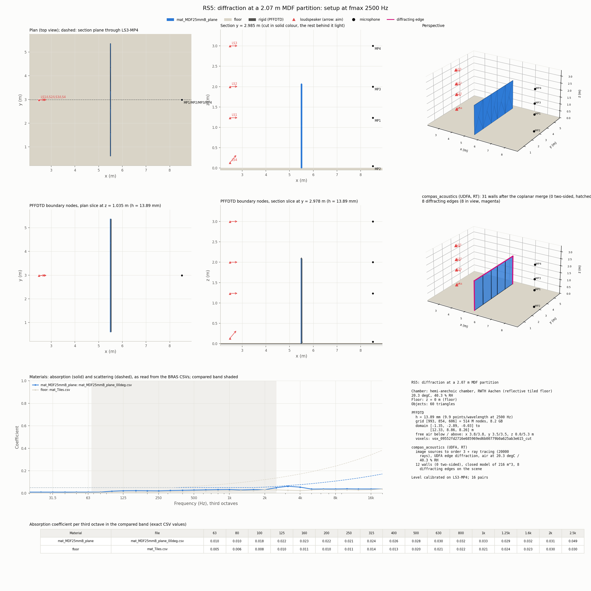
*RS5: a single 25 mm partition. Loudspeakers LS1–LS4 on the left, microphones MP1–MP4 on the right; MP2 lies on the floor.*

### 1.2 Engines and settings

- **PFFDTD** (reference): wave-based, compared from 67.5 Hz to 2.5 kHz, about 10 points per wavelength.
- **compas_acoustics `Mono`:**
  - image sources to order 3, plus ray tracing (20,000 rays);
  - measured source directivity; ISO 9613-1 air at the chamber's temperature and humidity;
  - compared from 67.5 Hz to 16 kHz;
  - run with `diffraction=False` and `"udfa"`.
- **BTMS test** (RS6 only, section 4). `Mono`'s diffraction step was patched in-process to render `hybrid.diffraction.btms_paths` contributions, exactly as `Mono._with_diffraction` renders UDFA paths, because `Mono` does not accept `"btms"`. A UDFA run without the source pattern was added so the comparison with BTMS is like-for-like.

### 1.3 Metric

- **Alignment and windowing.** Simulated and measured responses are band-limited alike, aligned on the direct sound and gated (direct sound plus early part).
- **Level difference.** dL = simulated − measured per 1/3-octave band. The figure of merit is the mean |dL| over the bands and then over the pairs.
- **Pairs with no sound.** A pair for which an engine finds no sound path is left out of that engine's mean. Without diffraction, that is every shadowed pair.
- **Calibration.** One global gain per engine and scene, fitted on the direct sound of a line-of-sight calibration pair. Section 2.2 explains why the UDFA run should instead take the gain of the run without diffraction.

### 1.4 Geometry for compas_acoustics

Every object is its oriented bounding box. A 25 mm plate therefore has two 90° edges on each side, 25 mm apart. Section 2.3 compares this with two-sided panels.

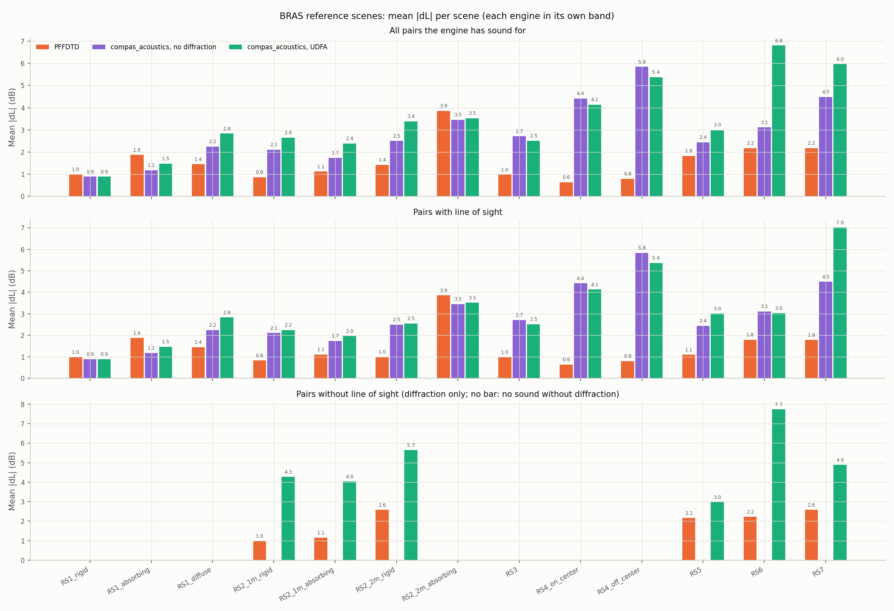
*Benchmark overview as run (boxes, one gain per engine).*

| Scene | PFFDTD LOS / shadowed | No diffraction (LOS only) | UDFA LOS / shadowed (shared gain) |
|---|---|---|---|
| RS1_rigid | 0.99 / – | 0.89 | 0.89 / – |
| RS1_absorbing | 1.87 / – | 1.18 | 1.41 / – |
| RS1_diffuse | 1.45 / – | 2.24 | **4.15** / – |
| RS2_1m_rigid | 0.83 / 1.00 | 2.11 | 2.20 / 4.24 (3 of 3) |
| RS2_1m_absorbing | 1.11 / 1.15 | 1.74 | 1.94 / 4.00 (3 of 3) |
| RS2_2m_rigid | 1.00 / 2.59 | 2.50 | 2.51 / 5.55 (4 of 4) |
| RS2_2m_absorbing | 3.86 / – | 3.45 | 3.26 / – |
| RS3 | 0.98 / – | 2.71 | 2.51 / – |
| RS4_on_center | 0.64 / – | 4.42 | 3.89 / – |
| RS4_off_center | 0.80 / – | 5.84 | 5.10 / – |
| RS5 | 1.10 / 2.17 | 2.44 | 3.00 / 2.23 (**2 of 11**) |
| RS6 | 1.79 / 2.22 | 3.11 | 3.74 / 5.23 (**4 of 8**) |
| RS7 | 1.78 / 2.58 | 4.49 | **11.20** / 6.02 (4 of 4) |

*Mean |dL| in dB; boxes geometry. The counts in brackets are shadowed pairs with any sound out of all shadowed pairs.*

---

## 2. UDFA (first order) — `hybrid.diffraction.diffraction_paths`

**How compas_acoustics applies it** (Kirsch & Ewert 2023):
- one wedge per path, every edge treated as an isolated infinite wedge, its apex clamped to the finite edge (`d_constrained`);
- at most one enclosure reflection, before or after the edge (see section 4.3 for the image construction);
- coherent rendering with the image sources;
- the lit-zone terms are ±½ of the incident or reflected wave at the shadow and reflection boundaries, which keeps the total field continuous;
- the source pattern is applied per path, from the first leg;
- the late field is not affected.

### 2.1 Over-counting in the lit zone

On line-of-sight pairs, UDFA only ever adds level:

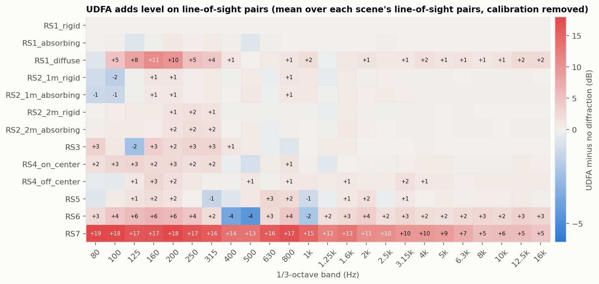

**Mechanism.** Take RS7 LS2-MP3, with the source at 0.52 m, the microphone at 0.34 m and the rows 0.24 m high:

| Pair | Diffracted paths found | Coherent sum relative to the direct sound |
|---|---|---|
| RS7 LS2-MP3 | **79** (61 in the reflection zone, 15 in the view zone, 2 in shadow) | **+12.7 / +13.2 / +13.7 / +13.7 / +3.4 dB** at 125 / 250 / 500 / 1k / 4k Hz; 11 paths within −12 dB of the direct sound |
| RS1_diffuse LS1-MP1 | 66 | +8.9 dB at 125 Hz |
| RS6 LS3-MP3 (grazing over the 0.72 m top) | – | +5.0 to +8.6 dB |
| RS2_1m LS1-MP1 (one plate, isolated edges) | 4 | −5.5 dB (well behaved) |

Close to a shadow or reflection boundary, each edge's term tends to ½ of the incident or reflected wave. With 15 parallel rows, each having two top edges 0.1–0.3 m from the path, many terms of that size add in phase. Physically, the second edge only receives what the first one lets through. That needs multi-edge diffraction, which is outside the isolated-wedge assumption.

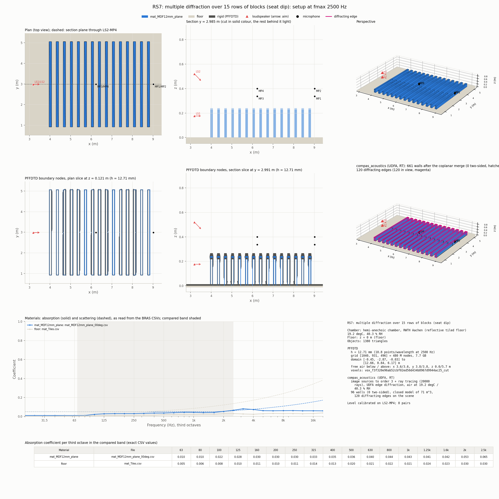
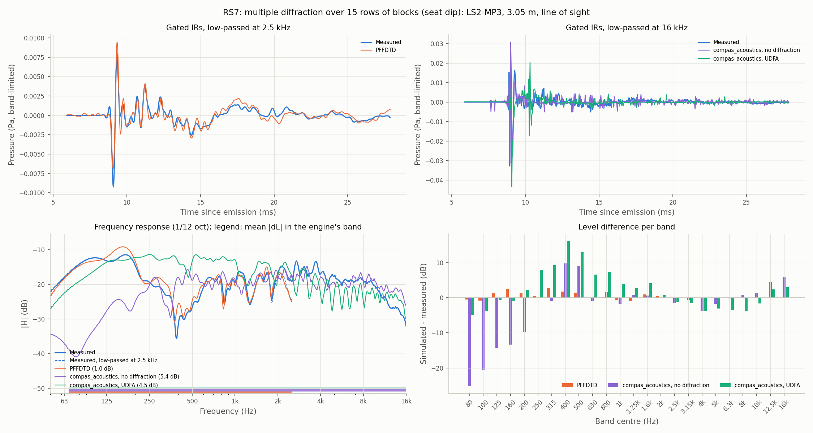
*RS7 LS2-MP3. UDFA (green) is +10 to +16 dB at 250–800 Hz, where the measurement shows the seat dip.*

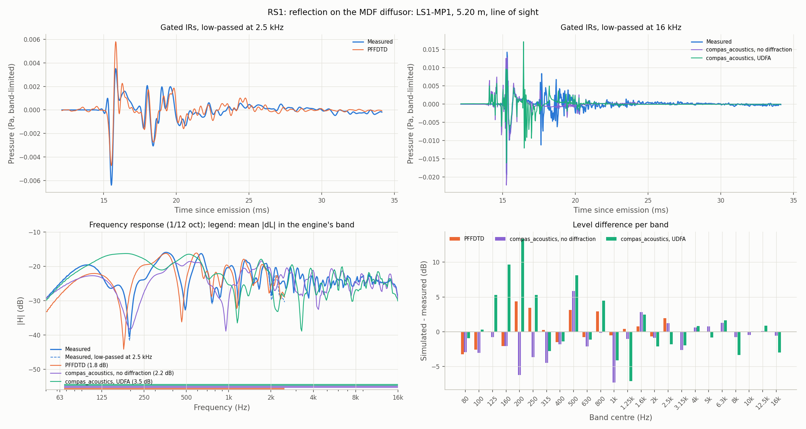

### 2.2 Calibrating on a line-of-sight pair hides it

In benchmarks this effect is easy to miss. Each engine's gain was fitted on the direct sound of a line-of-sight pair, and that pair is inflated by lit-zone diffraction, so the whole scene is turned down.

| Scene | Gain without diffraction (dB) | Gain with UDFA (dB) | Difference |
|---|---|---|---|
| RS7 | 80.70 | 74.97 | **−5.73** |
| RS1_diffuse | 83.63 | 81.05 | −2.58 |
| RS6 | 74.11 | 71.58 | −2.53 |
| RS5 | 81.26 | 79.57 | −1.69 |
| RS2, RS3, RS4 | – | – | −0.0 to −0.4 |

Giving the UDFA run the gain of the run without diffraction is the fair comparison, because diffraction should not change the calibration. It exposes the over-count (RS7 line of sight 7.02 → 11.20 dB) and credits UDFA where it is right (RS6 shadowed 7.74 → 5.23 dB, RS5 shadowed 2.97 → 2.23 dB, RS4 4.13 → 3.89 dB).

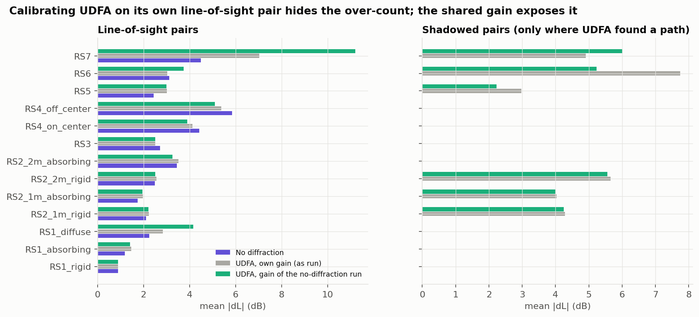

A single gain across all scenes does not work. The gain fitted without diffraction varies by 9.5 dB between scenes (74–84 dB) and PFFDTD's by 4.4 dB, which suggests the measurement level differs per scene.

### 2.3 Coverage behind bodies: a box is not a knife edge

First order cannot cross two edges. Behind a 25 mm plate modelled as a box, most shadowed receivers see neither edge on its own. Modelling the 25 mm plates and the partition as single two-sided faces gives one knife edge per side (θw = 2π). This was re-run with compas_acoustics only, using the shared gain:

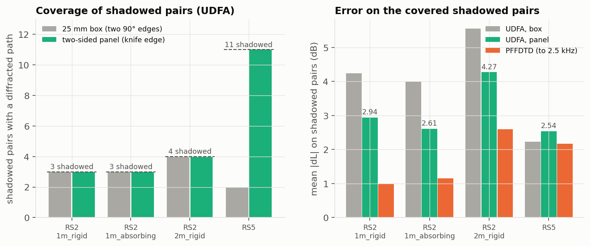

| Scene | No diffraction, box → panel | UDFA LOS, box → panel | UDFA shadowed, box → panel |
|---|---|---|---|
| RS2_1m_rigid | 2.11 → 2.12 | 2.20 → 2.13 | 4.24 → **2.94** |
| RS2_1m_absorbing | 1.74 → 1.74 | 1.94 → 1.87 | 4.00 → **2.61** |
| RS2_2m_rigid | 2.50 → 2.52 | 2.51 → 2.51 | 5.55 → **4.27** |
| RS5 | 2.44 → 2.58 | 3.00 → 3.00 | 2.23 (2 of 11) → **2.54 (11 of 11)** |
| RS4_on_center | 4.42 → **2.31** | 3.89 → **2.14** | – |
| RS4_off_center | 5.84 → **1.74** | 5.10 → **1.91** | – |
| RS3 | 2.71 → 2.72 | 2.51 → 2.72 | – |

- **RS4 improves even without diffraction.** Its fitted gain moved from 77.5 dB to 81.8–83.8 dB, in line with the other scenes, so nine thin boxes distorted the reflections and the calibration pair too. We did not isolate the exact mechanism (second reflecting faces, edge-sampling of thin faces in the mesh preparation).
- **The plates are acoustically thin.** At 25 mm the knife-edge limit holds below about 2–3 kHz: t ≪ λ/4 and kt < 1.
- **Remaining limitation.** A face carries one material, so the back of the RS2 absorbing plate takes the absorber's material.

### 2.4 Where UDFA makes acoustic sense in this benchmark

- **Valid:**
  - RS5, all pairs, as a panel: a single isolated knife edge.
  - RS2 shadowed pairs and pairs near the plate's reflection boundary, as a panel.
  - RS3 and RS4: edges of finite reflectors spaced far apart compared with the wavelength (finite-reflector correction).
- **Outside its assumptions:**
  - RS7 and RS1_diffuse: many parallel edges closer than a wavelength, at grazing incidence.
  - RS6 shadowed pairs: two thick edges in series.
- **Neutral:** RS1 rigid and absorbing, which have no free edges.

### 2.5 Variant tried and rejected: diffraction only for pairs whose line of sight is blocked

Applying UDFA only to shadowed pairs (mean |dL| over all pairs):

| Scene | No diffraction | UDFA everywhere | UDFA on shadowed pairs only |
|---|---|---|---|
| RS2_1m_rigid | 2.11 (12 of 15) | 2.65 | 2.54 |
| RS2_1m_absorbing | 1.74 (12 of 15) | 2.38 | 2.20 |
| RS2_2m_rigid | 2.50 (11 of 15) | 3.38 | 3.31 |
| RS5 | 2.44 (5 of 16) | 3.00 (7 of 16) | 2.38 (7 of 16) |
| RS6 | 3.11 (1 of 9) | 6.80 (5 of 9) | 4.80 (5 of 9) |
| RS7 | 4.49 (4 of 8) | 5.96 | 5.25 |

It scores better, but it is **not a sound rule for compas_acoustics**:
- **It is discontinuous.** UDFA is built so that the geometric sound plus the diffracted sound stays continuous across the shadow boundary. Switching diffraction per pair produces a jump of about 6 dB (½ in amplitude) as a listener crosses it.
- **It treats the symptom.** The problems are per path (grazing over parallel edges, thick bodies), not per pair. RS5 and RS6 coverage stays low.
- **It loses the finite-reflector benefit** on RS3 and RS4 (RS3 2.51 → 2.71, RS4 4.13 → 4.42 and 5.37 → 5.84 dB).

### 2.6 UDFA: limits and potential solutions

| Limit | Consequence | Potential solution |
|---|---|---|
| Each edge is an isolated wedge; the lit-zone terms of many close parallel edges add coherently | Over-estimates of +5 to +19 dB at grazing incidence (RS7, RS1_diffuse, RS6 line of sight) | (a) per obstacle and path, keep only the dominant edge (the first along the path) in the lit zone; (b) merge edges closer than about λ/4 at the frequency of interest; (c) the double-edge model for box tops (section 5); (d) BTMS for lit paths, since it showed no spurious lit-zone level on RS6 |
| First order only | Thick bodies (two edges in series) leave shadowed receivers silent or too quiet (RS6: 4 of 8 covered, 5.2 dB) | Double-edge model (box-type obstacles), or BTMS second order (section 4) |
| Thin solids are treated as two 90° edges | Coverage collapses behind plates (RS5 2 of 11); reflections are distorted too (RS4) | Thin-panel detection before simulation (section 6.1) |
| One reflection in total, before or after | Paths with a reflection on both sides are missed (minor for first order) | Optional image at each end, gated by the energy budget (section 4.4) |

---

## 3. No diffraction (image sources + ray tracing)

- **Line-of-sight pairs:** within 1–2.5 dB on most scenes. The exceptions are RS4 as boxes (4.4–5.8 dB, fixed by the panel geometry: 1.7–2.3 dB) and RS7 (4.5 dB).
- **Shadowed pairs:** silent, by construction.
- **Low frequencies at grazing:** large deficits where the direct sound is partly blocked, for example RS7 LS2-MP3 at −20 to −25 dB at 80–100 Hz (figure 11). That is the effect diffraction is meant to correct.

---

## 4. BTMS — `hybrid.diffraction.btms_paths`

**How compas_acoustics applies it today** (Svensson et al. 1999; Svensson's toolbox):
- **First order:** over every edge segment, with at most one wall reflection before or after (the same image construction as UDFA, section 4.3).
- **Order-0 components:** the scaled geometric components on zone boundaries.
- **Second order:** between visible edges, **on the direct path only** (`src, rec = sources[0], receivers[0]`). A thin plate gets the factor of 2 boost when its two edges lie along the same plane.
- **Where it runs:** only in the hybrid `Ambisonics` and `Binaural` methods. `Mono` rejects `"btms"`.
- **Source pattern:** contributions are omnidirectional; the hybrid warns when the source is directional.

### 4.1 Test case: RS6, a finite thick body

RS6 was chosen because its four shadowed pairs that UDFA reaches are within 8° of the loudspeaker axis, so the source pattern matters little. All its shadowed pairs need sound over the 0.72 m body.

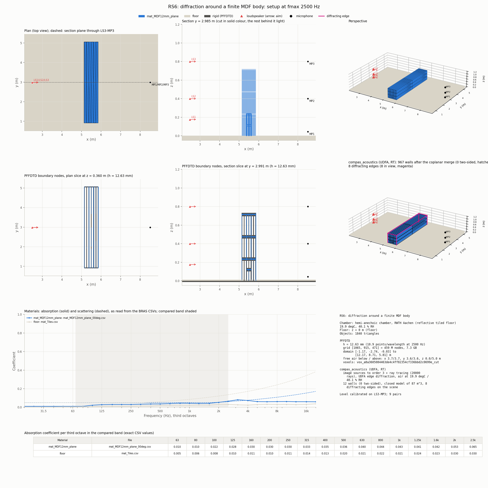
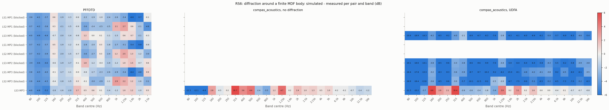
*The original benchmark run (boxes, one gain per engine). UDFA covers 4 of 8 shadowed pairs, 5 to 19 dB low.*

| Pair (LOS?) | No diffraction | UDFA (source pattern) | UDFA (omni) | BTMS (omni) |
|---|---|---|---|---|
| LS3-MP3 (LOS) | 3.11 | 3.74 | 3.74 | **3.05** |
| LS3-MP1 | – | 4.93 | 4.15 | 5.62 |
| LS3-MP2 | – | 4.96 | 4.07 | 7.34 |
| LS1-MP3 | – | 5.60 | 4.34 | 6.75 |
| LS2-MP3 | – | 5.43 | 4.65 | 7.67 |
| LS1-MP1 | – | no path | no path | 17.20 |
| LS2-MP1 | – | no path | no path | 15.98 |
| LS1-MP2 | – | no path | no path | 12.47 |
| LS2-MP2 | – | no path | no path | 11.32 |
| **Shadowed mean** | – | 5.23 (4 of 8) | 4.30 (4 of 8) | 10.54 (**8 of 8**); 6.85 on UDFA's 4 pairs |

*Mean |dL| in dB, every variant at the no-diffraction gain.*

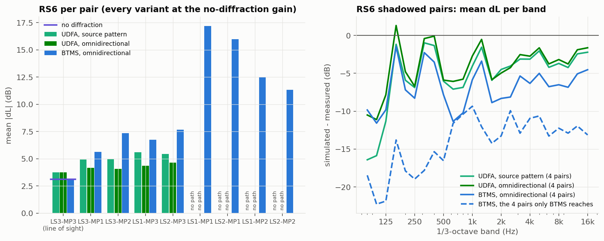

### 4.2 The scaling is correct; the missing energy is the floor

**Free-field check.** For the same pairs, with no wall reflections, BTMS first order matches UDFA first order within about 1 dB from 125 Hz to 4 kHz. The BTMS rendering scale is therefore right.

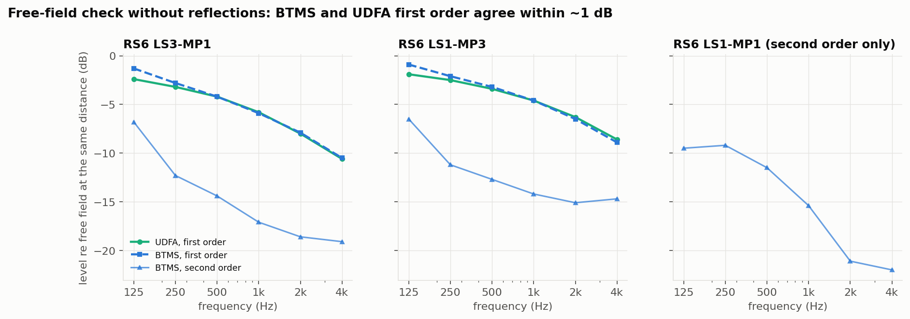

**Why the level is too low.** BTMS is 6–10 dB too low in every band on shadowed pairs, and 11–17 dB on the pairs that only its second order reaches. The geometry explains it. MP1 lies on the floor (z = 6 mm), LS1 is at 0.18 m, LS2 and MP2 at 0.40 m, LS3 and MP3 at 0.80 m, and the body is 0.72 m high. The path over both top edges exists in four versions:

1. source → edge 1 → edge 2 → receiver: computed;
2. reflected off the floor before the edges: **missing**;
3. reflected after the edges: **missing**;
4. reflected both before and after: **missing**.

With the source and receiver near the floor, these add nearly in phase: up to +6 dB for one reflection and +12 dB for all four. The errors follow the heights. They are largest when both ends are near the floor (LS1-MP1 17.2 dB, LS2-MP1 16.0 dB) and smallest at 0.4–0.8 m.

**Source pattern.** UDFA with the measured pattern is about 0.9 dB worse than without it here. Applying the pattern to BTMS would therefore change results by about a dB on this scene.

### 4.3 How the "one wall reflection" works today, and why second order lacks it

- **Images.** `_ends()` returns the real point plus its mirror image in every enclosure plane it is in front of. Coplanar faces are grouped per plane; obstacles are not mirrored.
- **Pairs.** First order iterates `[(S′, R) for every source image] + [(S, R′) for every receiver image]`. This deliberately excludes a reflection at both ends.
- **Wedge maths.** It runs unchanged on the image position, since mirroring preserves lengths and angles.
- **Back to the real path.** `_polyline()` maps the image leg to the real wall hit (`_wall_hit`, which must land on a face of that plane). `_clear()` checks every real leg. The gain takes √(1 − α) of the wall, and the direction of arrival comes from the real last leg.
- **Guard.** `_in_own_plane()` skips an image taken in the plane of the edge's own face.
- **Second order uses none of this:** `src, rec = sources[0], receivers[0]`.

### 4.4 Proposed extension: brute-force second order with images, an energy budget and a reduced sample rate

**Changes (all in `btms_paths`, plus enabling it in `Mono`):**

1. **Image ends for second order.** Iterate the same `(src, rec)` ends as first order, and optionally allow an image at *both* ends (`S′`–e1–e2–`R′`), which a receiver on the floor needs. Skip planes whose reflection is zero in every band, such as the absorbing shell of an open scene.
2. **Visibility from images.** In `prepare(e)`, `from_source` and `to_receiver` must test the reflected leg: `_wall_hit` on the segment midpoint must land on a face of the plane, and both real sub-legs must be clear. Apply `_in_own_plane()` to both edges. `_polyline` and `_clear` already accept several apexes. The gain is multiplied by √(1 − α) per reflection, and the direction of arrival comes from the real last leg.
3. **Energy-budget cut-off.**
   - Before integrating, estimate each candidate's level from its geometry (second order ∝ L₁L₂ / (r_S1 · r_12 · r_2R) × reflection factors).
   - Process the candidates in descending order. Stop once the estimated remaining tail is below a budget, for example 1% (−20 dB) of the kept second-order energy.
   - The budget must apply to the *sum* of what is discarded: a thousand contributions at −40 dB each add up to −10 dB.
   - Do the cut-off **before** the visibility tests. Those would otherwise dominate, since they do not scale with the sample rate.
4. **Second order at a reduced sample rate**, for example 12 kHz.
   - The integration grid per contribution scales with fs², because `element_grid` takes a step of about c/fs on each edge, so 12 kHz is about 16 times cheaper.
   - Upsample before adding. The per-sample amplitude must be divided by the upsampling factor, because a sample integrates over a 4× longer interval. Pad before the start for the interpolation filter's pre-ringing.
   - Second order is already 15–20 dB below first order at 2–4 kHz on RS6, so dropping it above about 5 kHz costs much less than 1 dB.
5. **Enable it in `Mono`.** Add `diffraction="btms"` and render the contributions the way `_with_diffraction` renders UDFA paths: `render_signals` of `ir / (4π)` with ones as weights. This is what the RS6 test did.
6. **Source pattern.** Weight each contribution by `source_gain(first-leg direction)`, as `diffraction_paths` does. This removes the omnidirectional limitation in `Mono` and in the hybrid.
7. **Validation.** A body standing on a rigid infinite floor gives the same field as the body plus its mirror image in free field. The new code with floor reflections must therefore match the mirrored 1.44 m body in free field. After that, compare with PFFDTD on RS6 below 2.5 kHz.

**Will the brute force give the same result as a hand-picked selection of planes?**
- **Plane selection: yes, or better.** All planes are a superset of "floor only". The energy budget then keeps the planes close to the source or receiver and drops distant or absorbing ones by itself.
- **Reduced rate: the same** below the reduced Nyquist frequency, to well under 1 dB.
- **Thin panels: no.** A box of thickness t ≪ λ needs third and higher orders across its top face to approach a knife edge, and the box still distorts the reflections (RS4). Thin-panel detection is still needed (section 6.1).

### 4.5 Cost

Measured on RS6 (one body, 8 edges, 9 pairs):
- **UDFA:** about 0.1–0.7 s per pair.
- **`btms_paths` today:** 1–3 s per pair (340–1,540 second-order contributions), about 2 ms per contribution.

Extrapolated to a furnished room (6 × 5 × 3 m, ten boxes of furniture giving about 80 edges and 120 obstacle faces, six reflecting planes):
- about 800 visible edge pairs from each end (about 4,000 contributions);
- 13 image combinations for a single reflection, 49 for one at each end;
- visibility tests about 10 times more expensive than in RS6.

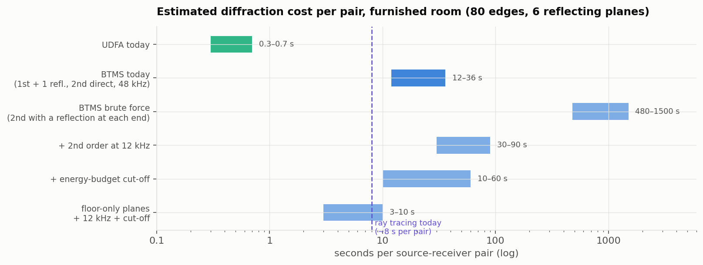

| | Per source–receiver pair | Compared with UDFA |
|---|---|---|
| UDFA today | ~0.5 s | 1× |
| BTMS today (first order + 1 reflection, second order direct only, 48 kHz) | ~12–36 s | ~25–70× |
| BTMS brute force (second order with a reflection at each end), 48 kHz, no cut-off | 8–25 min | ~1,000–3,000× |
| + second order at 12 kHz | 30 s – 1.5 min | ~60–200× |
| **+ energy-budget cut-off** | **~10–60 s** | **~20–100×** |
| Floor-only planes + 12 kHz + cut-off | ~3–10 s | ~5–20× |

These figures are extrapolated (±3×), not measured. Ray tracing (20,000 rays) already costs about 8 s per pair, so the brute force would raise the total run time about 2–8×, not 100×. With the cut-off and the reduced rate, brute force costs about as much as BTMS does today.

### 4.6 BTMS: limits and potential solutions

| Limit | Consequence | Potential solution |
|---|---|---|
| Second order on the direct path only | Shadows behind bodies on a floor are 6–12 dB too low (RS6) | Second order with image ends (section 4.4, items 1–2) |
| Cost grows with the square of the number of edges times the number of image combinations | Impractical in furnished rooms if done naively | Energy budget before visibility; second order at a reduced rate; optional selection of planes |
| Ambisonic and binaural only | Not available in the default mono workflow | Render in `Mono` (section 4.4, item 5) |
| Omnidirectional | About 1 dB on RS6; more for off-axis paths | `source_gain` per contribution (section 4.4, item 6) |
| No reflection between the two edges (edge → wall → edge) | Rarely relevant (needs a reflector between two edges) | Out of scope |
| Stops at second order | Seat-dip-type geometry (RS7, 15 rows) still not modelled | Out of scope for geometrical acoustics; wave-based below the crossover (the hybrid PFFDTD) |

---

## 5. Double-edge UDFA (`udfa.DoubleEdgePath`, not wired)

**What exists.** `udfa.py` implements the three-sided barrier of Kirsch & Ewert (2024): `DoubleEdgePath` and `double_edge_terms` give one weighted term in the double-shadow zone and two weighted terms in the view zone. Its docstring states it is not applied to room geometry.

**What it would solve:**
- **RS6 (thick body):** sound over both top edges in the double shadow.
- **RS7:** merges each block's two top edges into one weighted pair, roughly halving the lit-zone over-count. The 15 rows would still add independently.
- **Plates drawn as boxes:** also covered, though panel detection is simpler for those.

**What wiring it needs** (in `diffraction.py`):
1. **Pair detection.** Find parallel edges of one obstacle that share a face (`shared_face()` exists), each with an exterior angle of at most 3π/2.
2. **Projection.** Map the 3D source and receiver, including image ends, onto the cross-section to get θw1, θw2, width and φ.
3. **Apexes.** In the double shadow, find both apex points on the finite edges by unfolding, clamped as `d_constrained` is. Check them with `_polyline` and `_clear` (both already accept two apexes).
4. **Substitution.** Replace the two independent single-edge paths of such a pair with the `RouteTerm`s. `DiffractionPath.transfer` is already a callable, so the encoding is unchanged.
5. **Validation.** Compare against BTMS second order (section 4) and the paper's figures. The model assumes infinite edges, so finite length is an approximation.

We did not implement it. BTMS second order with images (section 4.4) covers RS6 more generally. The double-edge model remains the cheaper option if UDFA is to keep a second order.

---

## 6. Geometry pre-processing (wrapper side, but it determines diffraction quality)

### 6.1 Thin-panel detection

- **Single surfaces** are already handled: the mesh preparation finds air on both sides, marks the face two-sided, and the sector detector gives a knife edge (θw = 2π).
- **Thin solids** need detection per object:
  1. Cast a ray from each face's centroid into the solid. The first hit on an opposite-facing face of the same object gives the local thickness t.
  2. Classify the faces. Main faces have t ≤ t_max and an opposite partner. Rim faces are perpendicular to them and only about t wide. If the main faces carry more than about 90% of the object's area, the object is a panel. This also covers curved and L-shaped panels, which a bounding-box test misses.
  3. Collapse it only if *both* main faces face the air. A layer against a wall (an absorber, a lining) belongs to the wall.
  4. Keep one main face set, move it to the mid-surface, and drop the opposite faces and the rims.
- **Threshold.** Tie t_max to the wavelength: t_max ≈ c / (4 f) at the highest frequency where diffraction matters, 43 mm at 2 kHz. A default of about 50 mm keeps 18–47 mm boards and leaves stud walls as solids. Below λ/4, UDFA's isolated-wedge assumption between the two edges fails anyway.
- **Requested compas_acoustics addition:** a material per side of a two-sided obstacle face, if it does not exist yet.

The benchmark used a bounding-box version of this (`PraSpec.panels`, boxes ≤ 60 mm thick). It is what produced the section 2.3 results.

### 6.2 Selecting reflecting planes (only needed if the brute force is too slow)

- **Rule.** Cast a ray straight down from each source and receiver. The first face hit, if it faces the air upwards (normal within about 10° of +z) and reflects (√(1 − α) > 0.5), is that end's floor. Group the coplanar faces into the plane.
- **General form.** Keep reflecting planes within a few metres of the source or receiver.
- **Metadata.** Model categories (Revit or IFC "Floors" / `IfcSlab`) can confirm or override the choice.
- **compas_acoustics hook needed:** a plane selection honoured by `_ends()`, analogous to `set_diffraction_edges`.
- With the energy budget (section 4.4), this becomes a speed-up only, worth ×3–10 on second order.

---

## 7. Recommendations, by priority

| # | Change | Where | Fixes | Effort (estimate) |
|---|---|---|---|---|
| 1 | BTMS in `Mono` + source pattern per contribution | `simulation_methods/pra.py`, `btms_paths` | BTMS usable in the default workflow; omnidirectional limit (findings 4–5) | ½–1 day |
| 2 | BTMS second order with image ends + energy budget (before visibility) + reduced sample rate | `hybrid/diffraction.py` (`btms_paths`) | Thick bodies on floors (finding 3) | 1–2 days incl. the mirror-floor validation |
| 3 | Thin-panel detection | wrapper mesh preparation (compas_soundscape) | Coverage behind plates, reflections off plate arrays (finding 2) | 1–2 days |
| 4 | Lit-zone rule for UDFA (dominant edge per obstacle, or an edge-spacing criterion) | `diffraction_paths` | Grazing over-count (finding 1) | 1 day + validation on RS7 and RS1_diffuse |
| 5 | Wire `DoubleEdgePath` | `diffraction_paths` | Thick bodies with UDFA (cheaper than BTMS) | a few days |
| 6 | Benchmark practice: calibrate diffraction runs with the no-diffraction gain | benchmark | Hidden over-counts (section 2.2) | done in the compas_soundscape benchmark (uncommitted) |

---

## Appendix A — Reproduction

- **Benchmark driver:** `backend/tests/benchmarks/bras/bras_final.py` (compas_soundscape). Outputs go to `compas_soundscape_benchmarks/bras/final/<scene>/` (`results.json`, `report.md`, `plots/`).
- **Shared gain and panels:** `FinalSpec.ga_shared_gain`; `PraSpec.panels` / `bras_geometry.panel_boxes` (uncommitted in compas_soundscape).
- **BTMS test:** a scratch script patching `Mono._with_diffraction` in-process (with `parallel=False`) to render `btms_paths` contributions. Outputs are in `compas_soundscape_benchmarks/bras/btms_test/RS6/` (`summary.json`, cached responses). The UDFA-without-pattern variant uses the same patch with `diffraction_paths(..., source_gain=None)`.
- **Box versus panel:** a compas_acoustics-only re-run of RS2–RS5 written to the benchmark cache (`<scene>/f2500/runs`).
- **Figures:** generated from the files above; figures 10–18 are the benchmark's own plots, from the run with boxes and one gain per engine.

## Appendix B — Caveats

- The cost figures for the furnished room are extrapolated from the RS6 timings (±3×). Only the RS6 timings were measured.
- The RS6 BTMS test ran outside the supported path (a patched `Mono`). The scale was checked against UDFA in free field (section 4.2).
- The RS4 improvement from panels is larger than diffraction alone explains, and its mechanism was not isolated (section 2.3).
- PFFDTD is compared only up to 2.5 kHz. compas_acoustics is compared up to 16 kHz, so their mean |dL| values are not on the same band.
